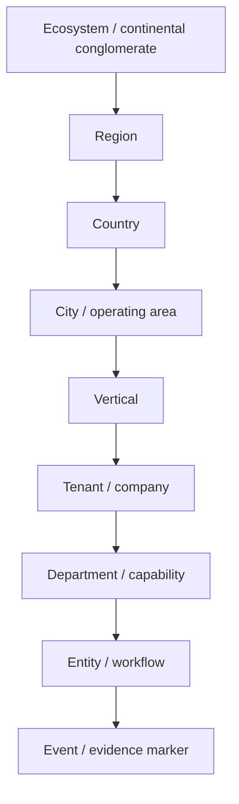
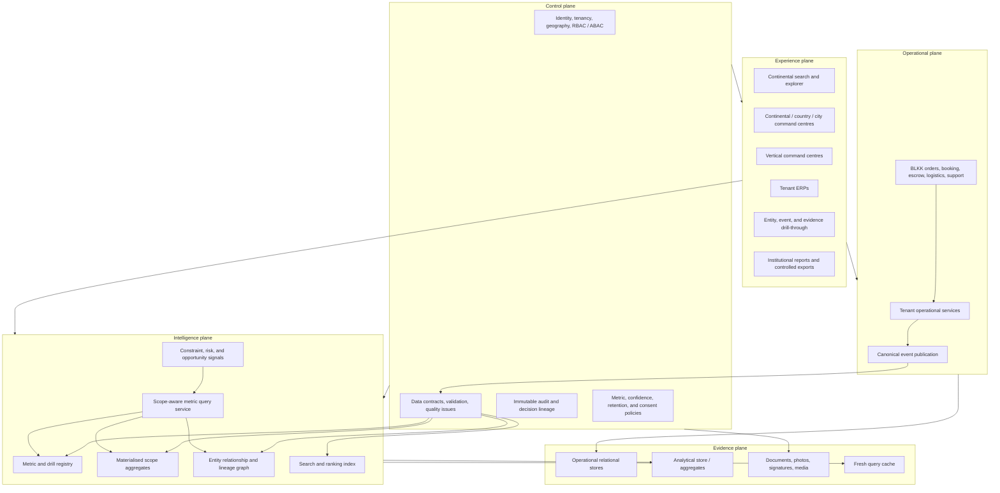

# Adinkra Continental Intelligence Architecture

**Status:** Living target architecture  
**Programme horizon:** 32-week frontend-first build  
**Last updated:** 28 July 2026  
**Product owner:** Founder/CEO, BLKK Star Hub and Adinkra Systems

**Start here:** [Adinkra Master System Mindmap](ADINKRA_MASTER_MINDMAP.md)

## 1. Purpose

Adinkra answers one question at progressively larger scopes:

> What is happening in this activity, store, shop, company, city, country, and continental conglomerate—and what evidence proves it?

The system is not a collection of dashboards. It is a continental business-intelligence system fed by operational ERPs.

- Tenant ERPs collect ground truth at the point of work.
- Vertical command centres aggregate comparable tenant activity.
- Geographic command centres aggregate city, country, regional, and continental activity.
- The global command centre exposes allocation, constraints, institutional trust, risk, and opportunity across the conglomerate.
- BLKK Star Hub, its apps, escrow, and BLKK Delivery turn intelligence into controlled action.

Adinkra must let an authorised executive move from a continental claim to the smallest relevant evidence record without making a phone call.

## 2. The Questions the System Must Answer

| Scope | Human question | Example answer surface |
|---|---|---|
| Evidence marker | What exactly happened? | Stock count, receipt, job card, payroll line, inspection photo, payment reference |
| Activity or entity | What is happening to this item, vehicle, employee, property, order, or case? | Entity record and event timeline |
| Department | What is happening in inventory, sales, workshop, HR, finance, marketing, logistics, or compliance? | Department control workspace |
| Tenant | What is happening in this store, shop, agency, farm, workshop, or company? | Complete tenant ERP |
| City | What is happening across our companies in this city? | City × vertical aggregation |
| Country | What is happening across our companies in this country? | Country portfolio and constraint view |
| Continent | What is happening across the conglomerate? | Continental portfolio, trust, risk, and opportunity |

The route down must be the inverse of the route up. If a value can aggregate to the top, the user must be able to drill back to the contributing records, subject to access policy.

## 3. Representative Acceptance Scenarios

### 3.1 Institutional inventory valuation

An executive in Kazakhstan opens Adinkra and tells a banker that current trusted inventory value is USD 5,000,000.

The banker asks, “How?”

The executive drills:

```text
Continental trusted inventory value
  → country contribution
    → city contribution
      → vertical contribution
        → tenant contribution
          → stock category
            → SKU / batch
              → receipt, count, supplier, valuation, and audit evidence
```

The number must show:

- scope and effective date;
- reporting currency and conversion rate;
- raw value and trusted value;
- confidence and freshness;
- contributing and excluded records;
- valuation method;
- evidence and audit lineage.

### 3.2 Last rare kente scarf

An executive in Paris searches for a rare kente scarf.

Adinkra returns verified merchant and product candidates ranked by:

- product match;
- stock availability and freshness;
- merchant verification;
- fulfilment reliability;
- product and store ratings;
- evidence completeness;
- location and delivery feasibility.

The executive drills:

```text
Search result
  → Merchants vertical
    → Koforidua
      → Mr Kofi's tenant ERP
        → product
          → variant
            → stock position: 1 available
              → last count and provenance
```

The customer is directed to BLKK Star Hub to order. BLKK remains the intermediary. Adinkra does not create direct buyer-to-seller commerce.

### 3.3 Best mechanic for a niche vehicle

An executive in Zimbabwe identifies the best eligible mechanic for a Nigerian motorist’s niche vehicle.

Ranking must consider:

- make, model, engine, and fault compatibility;
- certification and verified experience;
- first-pass quality;
- repeat-repair and recall rate;
- estimated-versus-actual completion;
- customer rating;
- open capacity and location;
- evidence confidence.

The drill ends at the mechanic’s tenant, performance history, supporting job cards, and an authorised handoff to BLKK Autos booking.

### 3.4 Wrongful termination and employment evidence

An employee in Kigali complains that she was terminated after raising a payroll or contract issue.

An authorised executive drills:

```text
Complaint
  → employee
    → storefront tenant
      → employment contract
      → attendance
      → payroll and adjustments
      → performance history
      → complaint chronology
      → access or role changes
      → termination event and authorising actor
```

The system does not decide the legal outcome. It preserves the evidence needed to review whether policy, contract, payroll, complaint, and termination procedures were followed.

## 4. Architectural Principles

### 4.1 One intelligence spine, many operational ERPs

Every tenant ERP is allowed to reflect its real operating model. A workshop board, a merchant catalogue, a farm aggregation lot, a property inspection, and a payroll ledger should not share one visual template.

They share:

- identity and tenancy;
- location hierarchy;
- event and evidence envelopes;
- metric definitions;
- audit lineage;
- search and access contracts;
- drill-through behaviour.

### 4.2 The tenant ERP is the sensing layer

Dashboards do not create truth. Operational actions create truth:

- receiving and counting stock;
- creating and completing job cards;
- issuing parts;
- recording sales and settlements;
- signing contracts;
- clocking attendance;
- running payroll;
- completing inspections;
- recording complaints;
- dispatching and delivering orders.

Metrics are derived from those events.

### 4.3 Every metric is a claim with evidence

No important number is only a rendered value. A metric observation includes:

- definition;
- scope;
- time window and as-of time;
- unit and currency;
- numerator and denominator;
- contributing records;
- exclusions;
- confidence;
- freshness;
- lineage;
- drill path;
- permitted actions.

### 4.4 Aggregation changes the decision

The same data can support different decisions at different scopes.

| Scope | Inventory question |
|---|---|
| SKU | Should this item be issued, counted, quarantined, or reordered? |
| Tenant | Which stock constraint will stop work or strand cash? |
| City × vertical | Which tenants can rebalance stock before external purchasing? |
| Country | Where is working capital trapped or service demand uncovered? |
| Continent | How should capital, logistics, insurance, or credit be allocated? |

Central dashboards must not repeat tenant-operating screens.

### 4.5 BLKK mediates commerce

All marketplace interest, negotiation, payment, escrow, fulfilment, disputes, and support are BLKK-mediated.

```text
Discovery → BLKK advisor/order → payment or escrow → BLKK fulfilment → evidence → release or dispute
```

Adinkra may recommend and initiate a controlled handoff. It never bypasses BLKK by creating direct buyer-to-seller trading.

### 4.6 AI assists but does not silently alter material truth

AI may:

- normalise informal descriptions;
- suggest classifications;
- flag anomalies;
- rank candidates;
- draft insights;
- recommend next actions.

AI must not silently:

- change financial ledgers;
- approve credit;
- release escrow;
- change inventory counts;
- terminate staff;
- publish unverifiable claims;
- hide conflicting evidence.

Material changes require a human decision, an actor, and an audit event.

## 5. Scope Hierarchy

The canonical scope hierarchy is:



Not every query must visit every level. A user may pivot from country to vertical, vertical to city, or entity to related entity. The hierarchy provides aggregation and access boundaries; the relationship graph provides flexible navigation.

## 6. Common Ontology Kernel

### 6.1 Identity and structure

- Ecosystem
- Region
- Country
- City / operating area
- Vertical
- Tenant
- Branch / storefront / workshop / site
- Department
- User
- Staff member
- Agent
- Role
- Policy

### 6.2 Market and asset

- Customer
- Merchant
- Supplier
- Product
- Variant
- Service
- Asset
- Vehicle
- Property
- Plot
- Crop
- Lot / batch
- Inventory position
- Listing
- Price

### 6.3 Work and commerce

- Lead / enquiry
- Appointment
- Work order
- Inspection
- Order
- Order line
- Reservation
- Stock movement
- Shipment
- Delivery
- Transaction
- Payment
- Escrow hold
- Payout
- Refund
- Dispute

### 6.4 Employment and governance

- Employment contract
- Schedule
- Attendance event
- Performance observation
- Payroll run
- Payroll line
- Leave request
- Complaint
- Investigation
- Corrective action
- Termination event
- Audit event

### 6.5 Evidence and trust

- Document
- Photo / video / audio
- Signature
- Location observation
- Verification decision
- Provenance record
- Rating / review
- Certification
- Consent
- Data-quality issue

## 7. Vertical Ontology Extensions

| Vertical | Primary extensions |
|---|---|
| Autos | Vehicle, VIN, job card, diagnostic finding, mechanic, bay, part fitment, recall, road test |
| Merchants | Store, catalogue, product, variant, stock position, shelf/bin, merchant rating, fulfilment |
| Estate | Property, title, landlord, agent, inspection, viewing, offer, lease, maintenance case |
| Farmers | Farmer, co-op, plot, crop, input, harvest, grade, aggregation lot, yield, post-harvest loss |
| BLKK Label | House, collection, design, production work order, material, finished good, franchise |
| Susu Rail | Member, contribution, cycle, wallet, collection, settlement, delinquency, mandate |
| Precious metals | Miner, licence, assay, lot, weight, purity, vault, custody transfer, export evidence |
| Field agents | Assignment, visit, capture, verification, onboarding, collection, commission, sync payload |
| Websites & apps | Website session, search query, page, app build, crash, API call, sync, release, acquisition event |

The common kernel enables cross-vertical questions. Extensions preserve domain truth.

## 8. Department Capability Map

Every tenant is mapped by capability, even when local job titles differ.

1. Operations and service delivery
2. Inventory and procurement
3. Sales, customers, and commercial pipeline
4. Finance, treasury, tax, credit, and payouts
5. HR, workforce, payroll, performance, and employee relations
6. Marketing, acquisition, content, and attribution
7. Logistics, routing, custody, and delivery
8. Compliance, trust, verification, disputes, and audit
9. Technology, integrations, data quality, and telemetry

A small shop may have one person performing several capabilities. Adinkra maps activities, not only titles.

## 9. Canonical Event Envelope

Every accepted operational change should be expressible through a common envelope.

```ts
interface BusinessEventEnvelope<TPayload> {
  eventId: string;
  eventType: string;
  eventVersion: number;
  occurredAt: string;
  recordedAt: string;

  ecosystemId: string;
  countryId: string;
  cityId?: string;
  verticalId: string;
  tenantId: string;
  branchId?: string;
  departmentId?: string;

  actorId: string;
  actorType: 'user' | 'staff' | 'agent' | 'system' | 'integration';
  sourceSurface: string;
  sourceRecordId: string;
  correlationId?: string;
  causationId?: string;

  payload: TPayload;
  evidenceRefs: string[];
  confidence: number;
  classification: 'public' | 'internal' | 'confidential' | 'restricted';
}
```

The envelope does not replace operational tables. It standardises how operational truth is published to the intelligence layer.

## 10. Metric Definition and Observation Contracts

### 10.1 Metric definition

```ts
interface MetricDefinition {
  metricId: string;
  name: string;
  description: string;
  ownerCapability: string;
  grain: string;
  unit: string;
  formula: string;
  numeratorDefinition?: string;
  denominatorDefinition?: string;
  supportedScopes: ScopeType[];
  dimensions: string[];
  allowedFilters: string[];
  aggregationRule: 'sum' | 'weighted_average' | 'ratio' | 'latest' | 'distinct' | 'custom';
  freshnessClass: 'live' | 'operational' | 'analytical';
  confidencePolicyId: string;
  drillDefinitionId: string;
  actionDefinitionIds: string[];
}
```

### 10.2 Metric observation

```ts
interface MetricObservation {
  metricId: string;
  scopeType: ScopeType;
  scopeId: string;
  periodStart: string;
  periodEnd: string;
  asOf: string;
  value: number;
  unit: string;
  reportingCurrency?: string;
  sourceCurrency?: string;
  exchangeRateRef?: string;
  numerator?: number;
  denominator?: number;
  confidence: number;
  freshnessSeconds: number;
  contributingRecordCount: number;
  excludedRecordCount: number;
  dimensions: Record<string, string>;
  lineageRef: string;
  drillRef: string;
}
```

### 10.3 Drill result

```ts
interface DrillResult {
  parentObservation: MetricObservation;
  nextScopeOptions: Array<{
    scopeType: ScopeType;
    scopeId: string;
    label: string;
    value: number;
    contributionPct: number;
    confidence: number;
    issueCount: number;
  }>;
  exclusions: Array<{
    reasonCode: string;
    recordCount: number;
    valueImpact?: number;
  }>;
  permittedActions: string[];
}
```

## 11. Metric Registry Requirements

No metric is added to a screen before it is registered.

Required registry fields:

1. Business question
2. Decision supported
3. Metric owner
4. Definition and formula
5. Grain
6. Scope support
7. Dimensions and filters
8. Source records and events
9. Inclusion and exclusion rules
10. Currency and unit treatment
11. Freshness target
12. Confidence policy
13. Drill path
14. Access classification
15. User action
16. Test fixture
17. Acceptance example

This prevents two dashboards from displaying the same label with different meaning.

## 12. Data Freshness Classes

| Class | Target | Examples |
|---|---:|---|
| Live | under 60 seconds | order status, delivery state, active sessions, payment acknowledgement |
| Operational | under 5 minutes | inventory availability, workshop state, agent verification queue |
| Nearline | under 1 hour | city capacity, credit exposure, channel performance |
| Analytical | daily or scheduled close | payroll, tax, monthly margin, institutional reports |

Every view displays freshness. Stale data is a visible state, not a hidden technical condition.

## 13. Confidence and Institutional Trust

Confidence is not a decorative score. It is derived from rules such as:

- source identity verified;
- record complete;
- evidence attached;
- corroborating records agree;
- count or inspection is recent;
- actor was authorised;
- no unresolved anomaly;
- no duplicate or conflicting event;
- currency or unit conversion verified.

Example:

```text
Raw inventory value:        USD 6.2M
Trusted inventory value:    USD 5.0M
Excluded from trusted value:
  - stale counts:           USD 0.6M
  - missing supplier proof: USD 0.3M
  - unit-cost anomalies:    USD 0.3M
Confidence: 87%
```

The institutional claim uses the trusted value while retaining the raw value and exclusions for investigation.

## 14. High-Level System Design



## 15. Logical Service Boundaries

Exact backend technologies are intentionally deferred until the backend repository is reviewed. The frontend depends on logical contracts.

| Boundary | Responsibility |
|---|---|
| Identity and scope | Users, roles, tenants, branches, locations, vertical membership |
| Operational adapters | Translate each ERP’s records into canonical events |
| Event acceptance | Validate schema, deduplicate, preserve causation and evidence |
| Ontology catalogue | Entity types, relationships, versioned vertical extensions |
| Metric registry | Definitions, formulas, dimensions, confidence, freshness, drill rules |
| Aggregate service | City, country, vertical, and continental roll-ups |
| Lineage service | Metric-to-record and entity-to-evidence trace |
| Search and ranking | Cross-vertical entity search, filters, ranking explanations |
| Signal service | Constraints, anomalies, opportunities, policy breaches |
| Report service | Reproducible, signed, scope-aware reports and exports |
| Action gateway | Controlled handoff to BLKK advisor, booking, order, escrow, delivery, support |
| Audit service | Authentication, mutation, access, decision, export, and policy events |

## 16. Data Storage Strategy

Use the right logical store for each workload.

| Workload | Logical storage |
|---|---|
| Tenant operations and financial books of record | Relational transactional store |
| Durable business-event publication | Transactional outbox plus durable queue/event log |
| Scope aggregates and analytical slices | Columnar analytical store or materialised relational aggregates |
| Entity relationships and lineage | Graph-capable relationship index; may begin relationally |
| Global product, merchant, mechanic, property search | Search index |
| Photos, contracts, certificates, invoices, media | Object storage with metadata and access controls |
| Hot metric observations | Cache with scope, filter, currency, and as-of keys |

Do not introduce every specialised datastore in the first implementation. Start with contracts and a relationally backed reference implementation. Add specialised stores only when query volume or complexity justifies them.

## 17. Aggregation Strategy

### 17.1 Additive metrics

Examples: trusted inventory value, collected revenue, order count.

Can sum when:

- the grain is non-overlapping;
- currency is normalised;
- record inclusion is consistent;
- duplicates are removed;
- the reporting time is aligned.

### 17.2 Ratios and rates

Examples: first-pass quality, fulfilment rate, payroll compliance.

Never average tenant percentages directly. Aggregate numerator and denominator, then calculate the ratio.

### 17.3 Latest-state metrics

Examples: current stock, active employee status, latest property verification.

Aggregate from the latest accepted state per entity as of the query time.

### 17.4 Rankings

Rankings must expose:

- eligibility criteria;
- metric weights;
- minimum evidence volume;
- confidence;
- tie behaviour;
- exclusions;
- why a result ranked above another.

“Best” cannot mean only highest revenue.

## 18. Frontend Information Architecture

```text
/
  Continental command centre

/scope/:scopeType/:scopeId
  Region, country, city, vertical, tenant, department, or branch summary

/search
  Cross-vertical entity and capability search

/:vertical
  Vertical central dashboard

/:vertical/tenant/:tenantId
  Tenant entry: choose Analytics or ERP

/:vertical/tenant/:tenantId/analytics
  Tenant analytical system

/:vertical/tenant/:tenantId/analytics/:module
  Departmental analysis and evidence drill

/:vertical/tenant/:tenantId/erp/:module
  Tenant operational record and command workspace

/metric/:metricId
  Metric explanation and scoped drill-through

/entity/:entityType/:entityId
  Entity record, relationships, timeline, evidence, and actions

/reports
  Institutional and executive report builder

/apps-website
  Digital client central dashboard

/apps-website/website/blkk-star-hub
  The one integrated commerce website

/apps-website/apps/:appId
  Native iOS / Android product telemetry
```

## 19. Frontend View Grammar

Every intelligence view should include only what supports the decision.

Required:

- scope breadcrumb;
- as-of time and freshness;
- active filters and currency;
- metric confidence where material;
- exception and exclusion visibility;
- meaningful drill controls;
- action handoff;
- empty, stale, error, and restricted states.

Avoid:

- one KPI/line-chart/ledger template repeated across modules;
- paragraphs explaining what a dashboard should demonstrate;
- cards that do not drill or act;
- rankings without evidence volume;
- values without units, definitions, or dates;
- central pages that duplicate tenant workflows.

## 20. Global Search Contract

Search is a first-class capability, not a navigation shortcut.

```ts
interface IntelligenceSearchRequest {
  query: string;
  scope?: { type: ScopeType; id: string };
  verticals?: string[];
  entityTypes?: string[];
  locationIds?: string[];
  availability?: 'available_now' | 'all';
  confidenceMinimum?: number;
  sort?: 'relevance' | 'trust' | 'performance' | 'distance' | 'availability';
}
```

Each result includes:

- matched entity;
- current scope and location;
- why it matched;
- availability or operating status;
- confidence and freshness;
- relevant performance;
- permitted drill path;
- BLKK action handoff where applicable.

## 21. Access Model

Use RBAC for broad responsibility and ABAC for record-level conditions.

Access dimensions include:

- role;
- tenant membership;
- department;
- geographic responsibility;
- vertical responsibility;
- data classification;
- purpose of access;
- consent;
- active investigation or case assignment.

An executive may view continental aggregates without automatically seeing every restricted employee, customer, medical, payroll, or complaint detail. Drilling into sensitive records requires purpose and policy.

Every denied, granted, exported, or unusually broad access is auditable.

## 22. Reliability and Scale Targets

Initial planning assumptions, to be revised with backend evidence:

- tens of thousands of tenants over time;
- millions of entities;
- high-frequency stock, order, session, and logistics events;
- intermittent connectivity for field and rural operations;
- multiple currencies, languages, time zones, and tax regimes;
- mobile-first operational collection;
- executive drill queries that should feel interactive.

Targets:

| Concern | Initial target |
|---|---|
| Tenant operational availability | 99.9% |
| Continental read availability | 99.9% |
| Common aggregate query | p95 under 2 seconds |
| Cached command-centre query | p95 under 500 ms |
| Entity drill | p95 under 2 seconds |
| Live-event visibility | under 60 seconds |
| Operational metric visibility | under 5 minutes |
| Audit durability | no accepted mutation without audit intent |
| Tenant isolation | zero cross-tenant leakage |

## 23. Offline and Intermittent Connectivity

Field apps and some tenant operations require:

- durable local draft queue;
- globally unique client event IDs;
- optimistic UI with explicit pending state;
- retry with backoff;
- conflict detection;
- server acceptance or rejection reason;
- duplicate prevention;
- last-sync status;
- supervisor review for material conflicts.

Offline data is not trusted merely because it synchronised. It enters the same validation and confidence process.

## 24. Observability

The system monitors:

- event acceptance, rejection, duplicate, and lag;
- metric freshness and calculation failures;
- drill lineage completeness;
- tenant adapter health;
- search indexing lag;
- confidence degradation;
- cross-tenant access attempts;
- action handoff success;
- report reproducibility;
- frontend route and interaction errors.

Operational telemetry belongs in Websites & Apps or System Control. Business activity belongs in the relevant domain command centre. A source-surface filter may connect the two without confusing them.

## 25. Key Trade-offs

### Federated ERPs versus one universal operational schema

**Decision:** common kernel plus vertical extensions.

- Easier: real workflows, domain accuracy, faster tenant adoption.
- Harder: adapter and ontology governance.
- Revisit: when repeated extension patterns justify promotion into the kernel.

### Precomputed aggregates versus calculating everything on demand

**Decision:** precompute common scope roll-ups; calculate rare slices on demand.

- Easier: interactive executive queries.
- Harder: invalidation, freshness, storage.
- Revisit: as query patterns and volumes become measurable.

### Event publication versus direct cross-database reporting

**Decision:** canonical event and metric contracts.

- Easier: lineage, versioning, independent ERP evolution.
- Harder: eventual consistency and adapter operations.
- Revisit: event infrastructure technology after backend audit.

### One search index versus vertical-only search

**Decision:** global index with vertical-specific ranking features.

- Easier: the kente and mechanic scenarios.
- Harder: permission filtering and ranking governance.
- Revisit: index partitioning at scale.

### Frontend-first contracts versus backend-first integration

**Decision:** stabilise experience and contracts with fixtures, then wire the backend.

- Easier: fast workflow validation and visible progress.
- Harder: fixtures can hide backend constraints.
- Mitigation: every fixture must name its future port, grain, source, and acceptance rule.

## 26. Definition of Done for Any New Slice

A slice is complete only when it has:

1. Observed or validated real workflow map
2. Business question and decision
3. Scope and user
4. Ontology entities and relationships
5. Event and evidence sources
6. Metric definitions
7. Typed frontend port
8. Realistic fixture including bad and incomplete states
9. Distinct operational or analytical interface
10. Working drill-through
11. Working action or controlled handoff
12. Freshness, confidence, and exclusions
13. Access and classification notes
14. Empty, loading, error, stale, and restricted states
15. Type, build, and browser verification
16. Living system map update

## 27. What We Will Revisit as the System Grows

- physical database and analytics technologies after backend review;
- regional data-residency requirements;
- event-bus scale and partitioning;
- graph database need versus relational lineage;
- metric materialisation and cache policy;
- multilingual ontology and search;
- currency and inflation treatment;
- external institutional access and signed reports;
- privacy rules for employee and customer cases;
- model governance for ranking and AI recommendations;
- tenant self-service configuration versus centrally governed standards.

## 28. North-Star Test

For any number, ranking, warning, or recommendation shown in Adinkra, an authorised user must be able to answer:

1. What does it mean?
2. What scope and time does it cover?
3. How fresh is it?
4. How confident are we?
5. What records contributed?
6. What was excluded and why?
7. Who or what changed it?
8. What decision can I make?
9. What happens if I act?
10. Can I prove this later?

If the system cannot answer those questions, it is not yet Adinkra intelligence.
