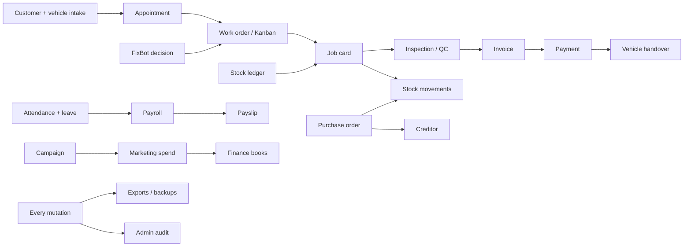

# AGL Operational ERP parity

**Status:** Frontend beta parity implementation in progress; verified capabilities are recorded below  
**Last verified:** 2026-08-02  
**Source reviewed:** `C:\Users\lenovo\OneDrive\Desktop\AGL Ops\AGL-website`

## Product boundary

Automobiles Ghana Limited now has two deliberate sibling systems inside Adinkra:

1. **Analytics** — the existing drill-through intelligence product.
2. **ERP** — the operating product where AGL staff create, change, approve, post, sign, print, export, and audit business records.

The Operational ERP does not add another BI dashboard. Small summaries appear only where they help an operator complete work. Analysis remains in the Analytics sibling.

## Source-to-target capability map

| AGL capability | Adinkra AGL Operational ERP |
|---|---|
| Workshop Kanban and status movement | `Job board` with drag-and-drop cards, governed transitions, stage selector, and job-card links |
| VSR detail | `Job cards` with accepted diagnosis, structured system/fault/severity/action findings, labour, parts, estimate approval, invoice, payment, quality, release, evidence, recall/remedy impact, correction, and audit lineage |
| Customer and vehicle intake | `Customer intake`, `Appointments`, `Customers`, and `Vehicles`, including one-step customer + first-vehicle registration |
| Parts on workshop jobs | Job-card part reservation/issue connected to stock movements and stock availability |
| Human and FixBot diagnosis | `FixBot` plus job-card diagnosis; accepted FixBot recommendations attach to an existing VSR or create a governed new VSR after human acceptance |
| Mechanic assignment and bay capacity | `Mechanic tracker` derives live workload from VSRs, prevents bay conflicts, assigns a governed work order, updates the board projection, and writes Admin Audit |
| Inventory master and fitments | `Parts catalogue` with registration, edit, multiple fitment add/remove, margin control, and governed retirement |
| Inventory event log | `Stock movements` with receipts, reservations, issues, returns, adjustments, counts, source references, and actors |
| Stock integrity | `Inventory control` with blind counts, independent variance approval, posting, transfers, quarantine, and provenance |
| Purchase orders | `Purchase orders` with request, approval, order, part receipt, finance creditor creation, and stock receipt |
| Supplier operations | `Suppliers` with master data, due diligence, review, and approval |
| Parts POS | `New sale` with live catalogue search, cart, discounts, tax, Ghana tender types, parked carts, stock deduction, and receipt |
| Sales records | `Sales ledger`, with customer, item, quantity, tender, source, status, and print/export lineage |
| Quotations and invoices | Separate `Quotations` and `Invoices`; accepted quotations can become invoices, and an originating VSR exposes an audited invoice print/PDF action when its invoice exists |
| Payments | `Payments` allocated against invoices with part-paid/paid balance logic |
| Customer history | `Customers` links fleet, service, sales, subscriptions, lifetime value, controlled edit, print, and history-safe retirement |
| Vehicle history | `Vehicles` retains VIN, documents, mileage, service dates, owner, and history-safe retirement |
| Service subscriptions | `Subscriptions` links plan, customer, vehicle, coverage period, billing cycle, and amount |
| Credit sales / creditors | `Creditors` and `Debtors` with ageing, partial settlement, balance, source document, and state |
| Expenses and P&L | `Expenses`, `Petty cash`, `Profit & loss`, `Finance journal`, and `Reconciliation` with approval/posting rules |
| HR roster and organisation | `Employees`, `Departments`, and `Organisation & positions`, including identity, statutory/benefit references, employment, pay basis, employee work envelope, payroll-only classification, approved positions, reporting lines, vacancies, assignment, role, and lifecycle |
| Onboarding and credentials | `Onboarding` runs a six-control employee-start checklist; `Certifications` retains issuer and certificate evidence, identifies expiry risk, and performs audited renewal |
| Manual/backdated attendance | `Attendance` with manager entry, clock-in/out, edit, Holiday/PTO/Sickday, source, notes, and unlogged-day control |
| Leave and overtime | `Leave & overtime` plus staff self-service request and manager approve/reject |
| Payroll | `Payroll` with attendance inputs, base pay, bonus, overtime, deductions, readiness, approval, processing, and payslip generation |
| Staff documents | `Documents`, `Contracts`, `Employee cases`, and immutable document/case event versions |
| Performance | `Performance` with mechanic and workforce operating records rather than a generic finance-shaped register |
| Schedules and training | `Schedules` provides a navigable seven-day staffing planner, uncovered-day and employee coverage counts, quick date seeding, and a status ledger; `Training` combines governed assignment/completion evidence with a role-derived competency coverage matrix, expiry risk, and activity history |
| Staff task control | `Staff tasks` for governed assignment, priorities, due dates, acceptance instructions, linked ERP evidence, drag-and-drop progression, and employee-side status updates |
| Staff portal and kiosk | `Staff portal` and `Clock kiosk` for time, leave, shifts, training, payslips, assigned tasks and workshop jobs, latest payroll position, source-derived personal performance, direct FixBot access, and a site-scoped scannable QR challenge that expires every 30 seconds with camera/manual verification; workshop supervisors also receive a live scoped VSR log |
| Recalls | `Recalls` connected to the original work order, remedy, stock returns, and reopened work |
| Complaints | `Complaints` with customer wording, ownership, resolution, signatures, retained closure, and print/PDF |
| Inspection / QC | `Inspections & QC` attached to the work order and release controls |
| Business and managerial reports | Separate report generators with report-family selection, drill filters, frozen snapshots, approvals, typed/drawn signatures, evidence export, and print/PDF |
| Printable job card | The live VSR produces an audited A4 print/PDF record containing customer concern, accepted diagnosis, structured diagnostic findings, labour, parts, release controls, financial state, recalls/remedies, and evidence lineage |
| Operational forms | `Forms` with governed submission, signatures, and approval state |
| Daily Entry | `Daily operations` with opening, closing, cash reconciliation, sales summary, stock check, handover, flags, edit, audited delete, CSV, and print/PDF |
| Data archives | `Data archives` with CSV/XLSX mapping, archive-only or ledger import, JSON merge/replace restore, validation, and audit |
| Export centre | Targeted CSV/XLSX, full multi-sheet ERP workbook, JSON backup, and audit CSV |
| Reminders | `Reminders` with reusable templates, customer/vehicle merge data, channel, delivery log, and notifications |
| Notifications | `Notification centre` with unread state and retained source reference |
| Marketing | `Campaigns`, `Promotions`, `Leads`, and `Marketing spend` connected to finance records |
| Users and roles | Purpose-built `Users` and `Roles & permissions`; invitation, inline audited role reassignment, credential reset, suspend/reactivate, self-demotion refusal, final-administrator protection, and no financial amount or “recorded value” fields |
| Tenant administration | `Branches & locations`, `Integrations`, and `ERP settings` |
| Audit | `Admin audit log` records login, create, update, status change, approval, signature, print, import, export, and deletion with actor and correlation identity |
| Global navigation | The tenant header includes an ERP/Analytics command palette with fuzzy page, department, setting, and quick-action search, keyboard navigation, recent selections, and direct route execution |
| Notification bell | The tenant header exposes live unread/all counts, recent retained notifications, acknowledgement controls, and a direct link to the full notification centre |

## Operating connections

## Frontend beta data contract

- The UI writes through one tenant-scoped operational repository rather than isolated component mock state.
- Cross-module workflows use shared correlation identities so one action can be followed across ledgers.
- The current browser adapter persists the beta dataset in `localStorage` and dispatches one ERP change event to update connected workspaces.
- Import/restore validates tenant, record lists, duplicate IDs, timestamps, and audit shape.
- Operational reports freeze point-in-time source totals before signing.
- Destructive master-data actions preserve history: linked customers, vehicles, and parts are archived; only dependency-free records can be removed.
- Backend wiring can replace the repository adapter without changing module UI contracts or the operational route model.

## Verification record

- TypeScript: `npx tsc --noEmit --pretty false`
- Production bundle: `npm run build`
- Live localhost route audit: service, inventory, sales, marketing, finance, people, management, and administration routes
- Live mutation check: manager-entered Sickday updated attendance, excused-day, and unlogged-day totals
- Live mutation check: accepted FixBot case created a VSR; Mechanic Tracker assigned the VSR to Nana Kojo Daniel and Bay 5, removed the assignment gap, and recalculated capacity
- Job-card check: the created VSR retained its FixBot diagnosis, mechanic and bay assignment, release controls, and printable controlled-record action
- Job-card check: the Quality & release tab exposes job-linked recalls and remedy/penalty impact; the Diagnosis tab adds and removes structured system, fault-code, severity, finding, and action rows
- Training check: the live module derives required capabilities by employee role and department, distinguishes current, pending, expired, missing, and non-required cells, and retains the existing evidence-completion activity workflow
- Staff-portal check: a selected employee can see attendance, leave, shifts, learning, payslips, assigned jobs, the latest governed payroll components, and job/quality/recall/complaint performance without a second data source
- Task-loop check: management created a high-priority wheel-alignment quality task linked to `VSR-2048`, moved it to `In progress`, and the same task, due time, instructions, source, and allowed next states appeared immediately in Appiah Joseph's Staff portal
- Schedule check: the live week planner exposes every day, empty coverage, date seeding, previous/next/current week controls, and the full governed schedule ledger as a separate view
- Clock check: the kiosk issues a real QR for an AGL site, rotates the challenge at expiry, and the Staff portal requires camera or fallback-code verification before recording a `QR kiosk` attendance source
- Employee-terms check: the scrollable employee editor exposes pay amount, compliance references, payroll-only classification, and expected work times; TypeScript verifies their attendance/payroll connections
- Administration check: Roles and Users contain access-control fields and no finance-shaped amount/recorded-value UI
- Administration check: the placeholder user fixture was replaced with a governed recovery administrator; self-demotion was refused, while a separate mock workshop identity was invited and promoted with the administrator count and audit evidence updating immediately
- Organisation check: the scoped East Legon structure retains approved workshop and service-advisor seats, filled/open state, reporting lines, and employee assignment
- Onboarding check: Nana Kojo Daniel's case opened against an approved position with all six controls, then advanced from `Not started` to `In progress` when identity evidence was completed
- Certification check: a Brake and ABS credential was registered as expiring, then renewed for one year; the risk count fell to zero and the current-credential count increased immediately
- Command-palette check: the header search filtered the full dual-system route catalogue for `attendance` and opened the operational Attendance workspace directly
- Notification check: the header bell exposes the retained notification panel and its direct route to the full notification centre
- Browser runtime console: no application errors in the verified route pass

## Recorded engineering follow-ups

- Vite reports a large client chunk after the full ERP surface is bundled. Route-level lazy loading should be introduced before production performance sign-off.
- The dependency audit still reports the React Router RSC-action CSRF advisory. This application is a Vite SPA and does not use React Server Components or server actions, so the affected execution path is absent. Reassess the advisory before enabling RSC or action endpoints.
- The vulnerable npm-published spreadsheet package was replaced with SheetJS `0.20.3`; spreadsheet import/export now builds without the prior SheetJS advisories.
